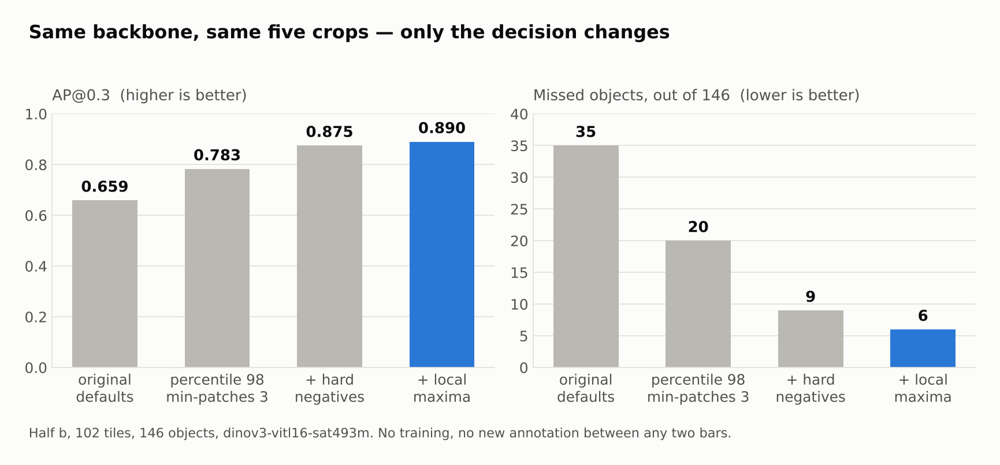
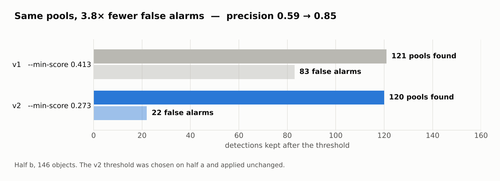
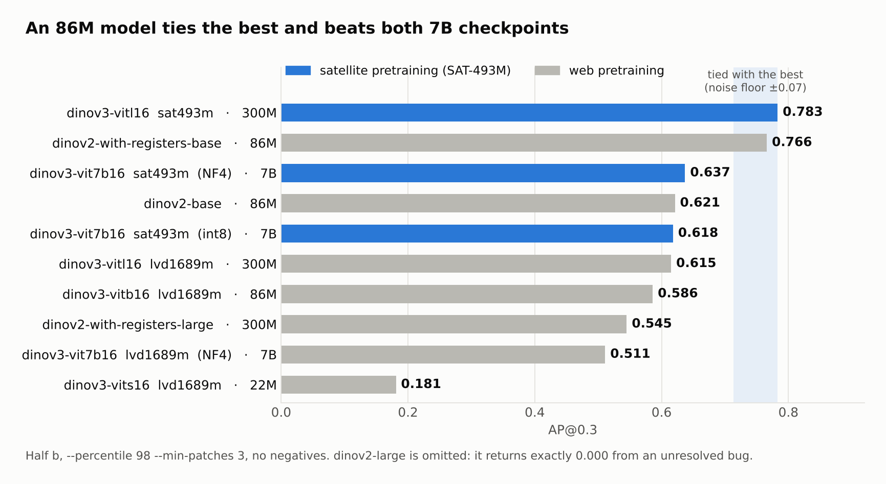
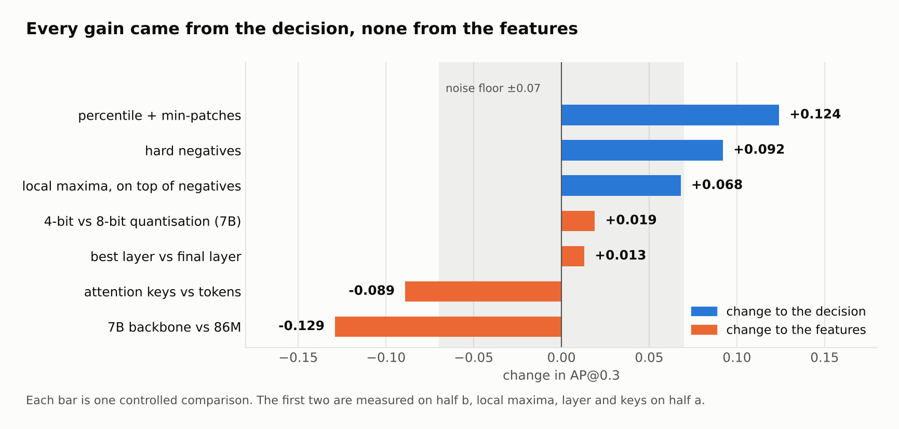

# 🏊 pool-fewshot

### Show it five swimming pools. It finds the rest.

No training, no fine-tuning, no labelled dataset: a frozen vision model, a
prototype built from five example crops, and a cosine similarity.

On 102 aerial tiles it had never seen, five crops found **140 of 146 pools
(96%)**. With one score threshold chosen on a separate half of the data, that
is **82% recall at 85% precision**.

Pools are the test, not the goal — swap the crops in `data/support5/` and it
looks for something else, with no code change. The target class is illegal
waste dumps, where no annotated dataset exists.



---

## Results

Half `b`: 102 tiles, 146 objects, 5 support crops,
`dinov3-vitl16-pretrain-sat493m`. The backbone is identical in every row.

| configuration | AP@0.5 | AP@0.3 | R@4fp | missed |
|---|---|---|---|---|
| `--percentile 99 --min-patches 1` (original defaults) | 0.467 | 0.659 | 0.568 | 35 |
| `--percentile 98 --min-patches 3` (v1) | 0.659 | 0.783 | 0.740 | 20 |
| + hard negatives (`--neg-weight 0.35`) | — | 0.875 | — | 9 |
| **+ local-maxima decoding (`--peak-rel 0.4`)** (v2) | **0.790** | **0.890** | **0.877** | **6** |

> **Noise floor: ±0.07 AP@0.3.** Measured, not guessed — smaller differences
> on this dataset are not measurements. [How it was measured →](docs/RESULTS.md)

### At the operating point



| | threshold | pools | false alarms | precision | recall |
|---|---|---|---|---|---|
| v1 | `--min-score 0.413` | 121 | 83 | 0.59 | 0.83 |
| **v2** | `--min-score 0.273` | **120** | **22** | **0.85** | **0.82** |

Threshold chosen on half `a`, applied unchanged to half `b` (whose own optimum
is 0.280). A looser point also exists: 133 pools for 44 false alarms, 91%
recall.

### Backbones



| model | params | AP@0.3 | AP@0.5 | R@4fp | s/tile |
|---|---|---|---|---|---|
| `dinov3-vitl16-pretrain-sat493m` | 300M | **0.783** | **0.659** | 0.740 | 0.24 |
| `dinov2-with-registers-base` | 86M | **0.766** | 0.556 | **0.760** | **0.13** |
| `dinov3-vit7b16-pretrain-sat493m` (NF4) | 7B | 0.637 | — | — | 2.4 |
| `dinov2-base` | 86M | 0.621 | 0.392 | 0.479 | 0.13 |
| `dinov3-vit7b16-pretrain-sat493m` (int8) | 7B | 0.618 | — | — | 3.1 |
| `dinov3-vitl16-pretrain-lvd1689m` | 300M | 0.615 | 0.286 | 0.541 | 0.86 |
| `dinov3-vitb16-pretrain-lvd1689m` | 86M | 0.586 | 0.325 | 0.555 | 0.09 |
| `dinov2-with-registers-large` | 300M | 0.545 | — | — | 0.29 |
| `dinov3-vit7b16-pretrain-lvd1689m` (NF4) | 7B | 0.511 | — | — | 2.4 |
| `dinov3-vits16-pretrain-lvd1689m` | 22M | 0.181 | — | — | 0.05 |
| `dinov2-large` | 300M | 0.000 *(bug, excluded)* | — | — | 0.29 |

- **Register tokens: +0.145 AP@0.3** (`dinov2-base` → `with-registers-base`).
- **Satellite pretraining beats web: +0.168** at 300M, and again at 7B
  (0.637 vs 0.511).
- **Bigger is not better:** the 86M model ties the best and beats both 7B
  checkpoints by 0.13.

---

## What made the difference



**Every gain came from how the heatmap becomes boxes. Nothing on the feature
side helped.**

**Hard negatives** (+0.092). Run the detector on tiles known to be empty: every
box it returns is false by construction. Keep the 40 highest-scoring crops and
subtract their similarity — `s(x) = cos(x, P⁺) − λ · max cos(x, P⁻)`. No new
annotation.

**Local-maxima decoding** (+0.068 on top of negatives). A percentile is a
budget, not a threshold: at `--percentile 98` it keeps 84 of 4225 grid squares,
an object covers 16, so no tile could return more than five objects — and
tiles here hold up to eight. Deciding per local maximum removes the ceiling.

The two compose (half `a`, 143 objects):

| | percentile | local maxima |
|---|---|---|
| **P⁺ only** | 0.720 — 23 missed | 0.766 — 12 missed |
| **P⁺ and P⁻** | 0.781 — 14 missed | **0.849 — 8 missed** |

Tried and rejected: 4-bit / 8-bit quantisation (no effect, so it is a free
memory saving), a 7B backbone (worse), other layers (no effect), attention keys
instead of tokens (0.644 vs 0.733, worse).
[Details →](docs/RESULTS.md)

---

## Install

```bash
python -m venv .venv && source .venv/bin/activate
pip install torch --index-url https://download.pytorch.org/whl/cu121   # RTX 50xx: cu128
pip install -r requirements.txt
python run.py selftest
```

DINOv3 weights are gated: accept the licence on the model page, then
`hf auth login`.

## Quick start

```bash
# 1. choose the 5 support crops (on half a)
python rank_support.py --half a --top 30
python pick_support.py --n 5 --from data/candidates --to data/support5 --sheet

# 2. mine hard negatives from the empty tiles (on half a)
python mine_negatives.py --half a --top 40 --sheet

# 3. evaluate on half b
python run_dense.py --support-dir data/support5 --half b \
  --model facebook/dinov3-vitl16-pretrain-sat493m \
  --min-patches 3 \
  --neg-dir data/negatives --neg-weight 0.35 \
  --decode peaks --peak-rel 0.4

# 4. predict on new imagery, with the threshold
python predict.py --images data/tiles --support-dir data/support5 \
  --model facebook/dinov3-vitl16-pretrain-sat493m \
  --min-patches 3 \
  --neg-dir data/negatives --neg-weight 0.35 \
  --decode peaks --peak-rel 0.4 \
  --min-score 0.273 --sheet
```

`dinov2-with-registers-base` is the lighter choice: tied on AP@0.3, 2× faster,
not gated.

---

## Limits

146 objects, one city (Cannes), one flight campaign. `dinov2-large` returns
0.000 from an unresolved bug. Ground truth has missing annotations, so
precision is a lower bound.

## Next steps

This is v2. Everything that worked so far was on the decision side, so that is
where I continue first.


**Medium term — more data, other models**

- [ ] Remote-sensing backbones: Prithvi, Clay, SatMAE, Scale-MAE — satellite
      pretraining is the only feature-side change that paid (+0.168).
- [ ] SigLIP2 and AIMv2, already loadable but never benchmarked.

**Longer term — changing the method**

- [ ] Semi-supervised self-training: pseudo-label the confident detections and
      rebuild the prototype from them.
- [ ] A small learned head on the frozen features, as the honest comparison
      to "training-free".
- [ ] Move to the real target: **illegal waste dumps**, from a handful of
      examples.

Full reasoning for each item: [docs/METHODOLOGY.md §12](docs/METHODOLOGY.md).

## More

| | |
|---|---|
| [docs/RESULTS.md](docs/RESULTS.md) | noise floor, all measurements, the five rejected hypotheses |
| [docs/METHOD.md](docs/METHOD.md) | how both additions work, data preparation, thresholding |
| [docs/METHODOLOGY.md](docs/METHODOLOGY.md) | evaluation traps, limitations, roadmap |
| [CHANGELOG.md](CHANGELOG.md) | v1 → v2 |

Data: the pool dataset of
[EcoAI](https://github.com/zou4all/EcoAI-Intelligent-Innovations-for-a-Greener-Future)
(YOLOv5m, 883 annotated images) — here, five crops and no training.
Figures are regenerated by `python docs/img/make_figures.py`.

I am learning this in the open: if you spot something wrong, please tell me ;)